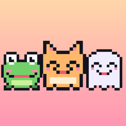
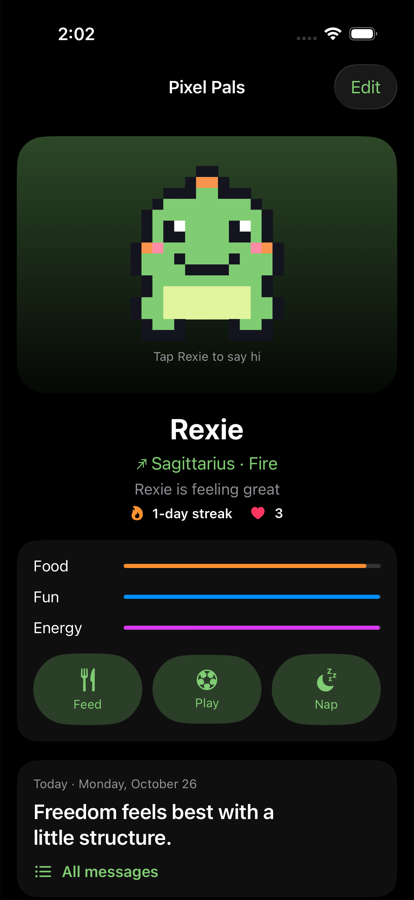
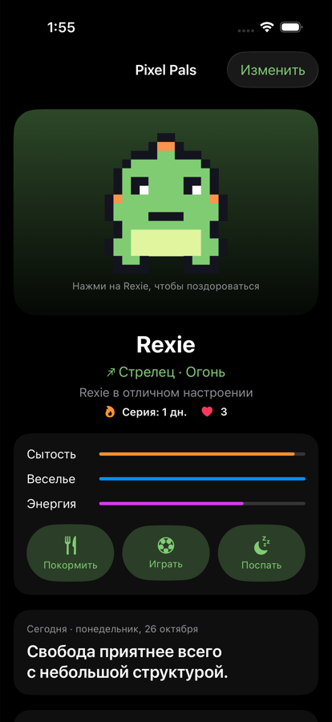
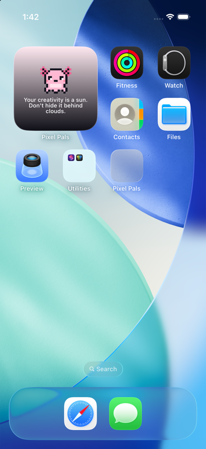

# Pixel Pals

A tiny pixel pet for your iPhone. Pick one of 8 pals, give it a name, take care of it, and get a kind message every day — in the app, the Dynamic Island, widgets and notifications. English and Русский.

▶️ **[Watch the 15-second promo](docs/promo.mp4)**

## Features
- **8 pixel pets** (cat, dog, bunny, frog, ghost, penguin, axolotl, dino) at 16×16, with blinking, happy wiggles and tap-for-hearts.
- **Care:** Food, Fun and Energy drain over the day; Feed, Play and Nap with little animations. Daily streak and friendship hearts.
- **Emotions:** happy, fine, hungry, bored, sleepy or sad (with a tear), from the care levels. Reactions (❤️, ⭐) after feeding, playing and petting.
- **Accessories:** hearts unlock a bow, sunglasses, a party hat and a crown, worn in the app, the island and the widget.
- **Lives in the Dynamic Island:** curious head tilt while you use the phone, falls asleep on the Always-On Lock Screen. Battery-friendly: no constant updates, just one background wake-up around each expected mood change.
- **Daily content, your choice:** a message for your zodiac sign (240 per language), a classic quote, a light daily horoscope, your own messages, or a mix.
- **Write your own messages** and they join the rotation.
- **Dynamic Island & Lock Screen** Live Activity, **Home/Lock Screen widgets**, optional daily and care reminders.
- **Languages:** English and Russian, switchable in the app.
- No accounts, ads or tracking. Everything stays on the device.

## Install
Download **Pixel-Pals.ipa** from [Releases](../../releases) and install it with AltStore — step-by-step guide in [INSTALL.md](INSTALL.md) (English and Russian).

## Build from source
Needs Xcode 16+ and [XcodeGen](https://github.com/yonaskolb/XcodeGen) (`brew install xcodegen`).

1. `xcodegen generate`, then `open IslandHub.xcodeproj`.
2. Set `APP_BUNDLE_ID` in `project.yml` to your own ID (the widget ID and App Group derive from it).
3. Pick your team under Signing & Capabilities and run.

Scripts in `tools/`:
- `install-free.sh <TEAM_ID> <DEVICE_ID>` — install on your own iPhone with a free Apple ID (no App Group, so the widget can't see the pet).
- `release.sh <TEAM_ID> <BUNDLE_ID>` — archive and upload to App Store Connect / TestFlight (paid developer account).
- `make_icon.py` — regenerates the app icon from the pet sprites.

## Project layout
- `Shared/Pets.swift` — the pets as 16×16 sprites (idle, blink, happy) and their drawing/animation
- `Shared/PetCare.swift` — care levels, actions, streak, hearts
- `Shared/Zodiac.swift`, `Shared/DailyContent.swift` — signs and the daily message (sign message, quote, horoscope, my messages, mix)
- `Shared/en.lproj`, `Shared/ru.lproj` — messages, quotes, horoscope parts and interface text per language
- `Shared/AppLanguage.swift` — in-app language switch, shared with the widget
- `Shared/PetProfile.swift` — storage in the App Group and the Live Activity state
- `IslandHub/` — app screens and the model that keeps island, widget and notifications in sync
- `IslandWidget/` — Dynamic Island / Lock Screen Live Activity and the Home Screen widget
- `AppStore/` — store listing (EN/RU) and privacy policy
- `promo-video/` — the promo video as a [HyperFrames](https://hyperframes.heygen.com) project; `python3 tools/make_assets.py` exports the sprites and soundtrack from the app, `npm run render` renders it
