

  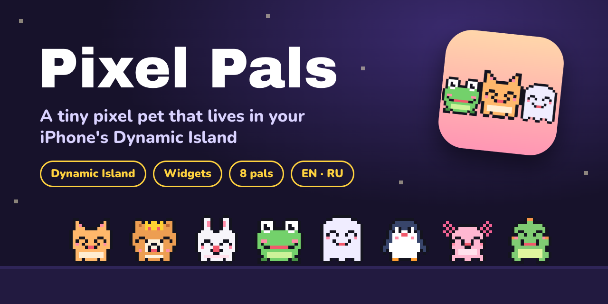

  
  
  
  
  

  <b>Feed it, play with it, dress it up — and get a kind message every day.</b> 
  Your pal lives in the Dynamic Island, shows how it feels, and falls asleep when your phone does.

  <a href="https://github.com/pinghub25/pixel-pals/releases/latest"><b>⬇️ Download</b></a> &nbsp;·&nbsp;
  <a href="INSTALL.md"><b>📲 How to install</b></a> &nbsp;·&nbsp;
  <a href="docs/promo.mp4"><b>▶️ Promo video</b></a> &nbsp;·&nbsp;
  <a href="INSTALL.md#как-установить-pixel-pals-на-iphone"><b>🇷🇺 По-русски</b></a>

 

<table align="center">
  <tr>
    <td align="center">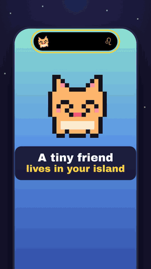 15-second promo</td>
    <td align="center"> Your pal and today's message</td>
    <td align="center"> Home Screen widget</td>
  </tr>
</table>

## Meet the pals

<table align="center">
  <tr>
    <td align="center">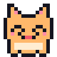 <b>Mochi</b> cat</td>
    <td align="center">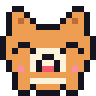 <b>Kuma</b> dog</td>
    <td align="center">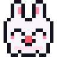 <b>Puff</b> bunny</td>
    <td align="center">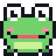 <b>Pip</b> frog</td>
    <td align="center"> <b>Boo</b> ghost</td>
    <td align="center"> <b>Waddle</b> penguin</td>
    <td align="center">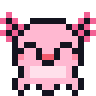 <b>Lolo</b> axolotl</td>
    <td align="center">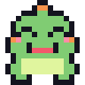 <b>Rexie</b> dino</td>
  </tr>
</table>

Pick one, give it any name, and enter your birthday — that sets your zodiac sign for the daily messages.

## What your pal does

### 🏝 Lives in your Dynamic Island
Your pal sits in the island with your zodiac sign beside it. It **tilts its head curiously** while you use your phone, reacts with ❤️ or ⭐ when you feed it or play, and **falls asleep on the Always-On Lock Screen**. Long-press the island for its mood, today's message and its care bars.

### 💛 Has feelings

<table>
  <tr>
    <td align="center"> happy</td>
    <td align="center">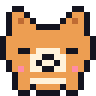 sleepy</td>
    <td align="center">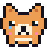 sad</td>
  </tr>
</table>

Food, Fun and Energy slowly drain through the day. Your pal is happy, fine, hungry, bored, sleepy — or sad, with a little tear, when it's been left alone too long.

### 🍎 Needs your care
**Feed** it (an apple drops in and it munches), **play** ball, or let it **nap**. Tap it for floating hearts. Keep a **daily streak** going and get an optional nudge when your pal needs you.

### 🎀 Dresses up

<table>
  <tr>
    <td align="center">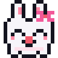 Bow 10 ♥</td>
    <td align="center">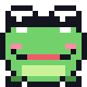 Sunglasses 25 ♥</td>
    <td align="center">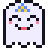 Party hat 50 ♥</td>
    <td align="center">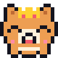 Crown 100 ♥</td>
  </tr>
</table>

Hearts from petting, feeding and playing unlock accessories. Your pal wears them in the app, the Dynamic Island and the widget.

### ✨ A kind message every day
Choose what you get: a note for your **zodiac sign** (240 of them), a **classic quote**, a light **daily horoscope**, **your own messages**, or a **mix** of all of them. It shows in the app, the island, the widget and an optional daily notification.

### 🌍 English and Русский
Switch the language right in the app — the widget, island and notifications follow.

### 🔋 Battery-friendly and private
No constant updates: the island changes only when something visible changes, with at most one quick background wake-up when your pal's mood is due to change (none in Low Power Mode). No accounts, ads or tracking — everything stays on your iPhone.

## Install

Pixel Pals isn't on the App Store yet. Install it for free with [AltStore](https://altstore.io):

1. Set up AltStore on your iPhone once, using a Mac or Windows PC.
2. Download **Pixel-Pals.ipa** from the [latest release](https://github.com/pinghub25/pixel-pals/releases/latest).
3. Open it in AltStore → **My Apps** → **+**.

Full step-by-step guide: **[INSTALL.md](INSTALL.md)** (English and Russian). Needs iOS 17 or newer.

<b>For developers</b>

### Build from source
Needs Xcode 16+ and [XcodeGen](https://github.com/yonaskolb/XcodeGen) (`brew install xcodegen`).

1. `xcodegen generate`, then `open IslandHub.xcodeproj`.
2. Set `APP_BUNDLE_ID` in `project.yml` to your own ID (the widget ID and App Group derive from it).
3. Pick your team under Signing & Capabilities and run.

Scripts in `tools/`:
- `install-free.sh <TEAM_ID> <DEVICE_ID>` — install on your own iPhone with a free Apple ID (no App Group, so the widget can't see the pet).
- `release.sh <TEAM_ID> <BUNDLE_ID>` — archive and upload to App Store Connect / TestFlight (paid developer account).
- `make_icon.py` — regenerates the app icon from the pet sprites.

### Project layout
- `Shared/Pets.swift` — the pets as 16×16 sprites (idle, blink, happy, sad), accessories, drawing and animation
- `Shared/PetCare.swift` — care levels, emotions, actions, streak, hearts
- `Shared/Zodiac.swift`, `Shared/DailyContent.swift` — signs and the daily message (sign message, quote, horoscope, my messages, mix)
- `Shared/en.lproj`, `Shared/ru.lproj` — messages, quotes, horoscope parts and interface text per language
- `Shared/AppLanguage.swift` — in-app language switch, shared with the widget
- `Shared/PetProfile.swift` — storage in the App Group and the Live Activity state
- `IslandHub/` — app screens and the model that keeps island, widget and notifications in sync
- `IslandWidget/` — Dynamic Island / Lock Screen Live Activity and the Home Screen widget
- `AppStore/` — store listing (EN/RU) and privacy policy
- `promo-video/` — the promo as a [HyperFrames](https://hyperframes.heygen.com) project: `python3 tools/make_assets.py` exports the sprites and soundtrack from the app, `npm run render` renders it
- `press-kit/` — the README banner (also a good GitHub social preview image)

## License

[MIT](LICENSE) © 2026 Matvey Savin
